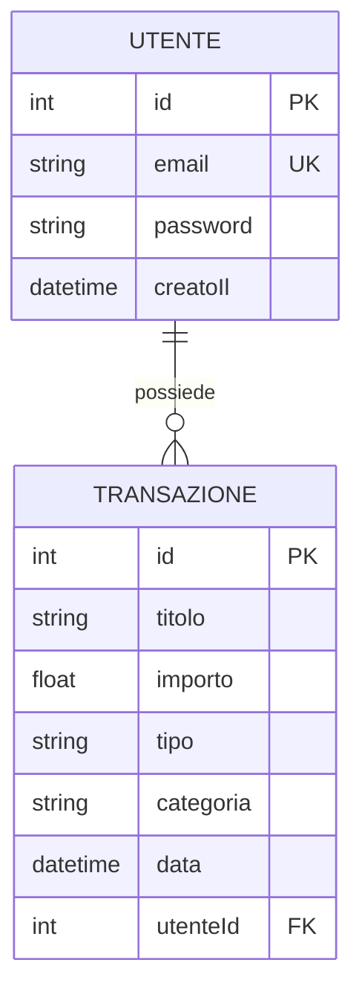

# 💼 FinanceFlow — Full-Stack Personal Finance Tracker

[](https://react.dev/)
[](https://www.typescriptlang.org/)
[](https://vitejs.dev/)
[](https://nodejs.org/)
[](https://expressjs.com/)
[](https://www.prisma.io/)
[](https://www.sqlite.org/)
[](https://jwt.io/)

**FinanceFlow** è un'applicazione web Full Stack moderna per la gestione delle finanze personali e il tracciamento delle spese quotidiane.  
Sviluppata da zero con architettura a due livelli (Client SPA in React + TypeScript e Backend RESTful in Node.js/Express con Prisma ORM e SQLite).

---

## 🌟 Funzionalità Principali

* **🔐 Autenticazione & Sicurezza Completa:**
  * Registrazione e Login con hashing a senso unico delle password tramite **Bcrypt** e Salt casuale.
  * Sessioni stateless gestite con **JSON Web Token (JWT)** memorizzati in `localStorage`.
  * Middleware di protezione rotte: ogni utente può visualizzare e gestire esclusivamente i propri dati (*Data Isolation*).
* **📊 Dashboard Finanziaria Reattiva:**
  * Calcolo istantaneo del **Saldo Netto**, delle **Entrate Totali** e delle **Uscite Totali** in tempo reale.
  * Formattazione valutaria automatica nello standard italiano (`€ 1.450,00`).
  * Alert visivo condizionale in caso di saldo passivo.
* **➕ Gestione Transazioni (CRUD):**
  * Creazione di movimenti con categorizzazione automatica (Cibo, Casa, Lavoro, Svago, Trasporti, Salute, Animali, Altro).
  * Validazione rigorosa degli importi positivi e sanitizzazione del testo.
  * Eliminazione sicura delle transazioni con controllo di proprietà lato server.
* **🔍 Filtri e Ricerca Avanzati:**
  * Filtro rapido per tipologia (*Tutte*, *Solo Entrate*, *Solo Uscite*).
  * Barra di ricerca istantanea sul titolo della transazione.
* **🎨 UI/UX Moderna e Responsive:**
  * Tema scuro (*Dark Tech*) rifinito con CSS Grid e Flexbox, ottimizzato sia per desktop che per smartphone.

---

## 🏗️ Architettura del Sistema

```mermaid
flowchart LR
    subgraph Client ["Frontend (Porta 5173)"]
        Vite["Vite + React 19 + TypeScript"]
        State["State Management & Hooks"]
        Comp["Componenti Atomici TSX"]
    end

    subgraph Server ["Backend (Porta 3000)"]
        Exp["Node.js + Express API"]
        Auth["Middleware JWT + Bcrypt"]
        ORM["Prisma Client v6"]
    end

    subgraph DB ["Database"]
        SQLite["SQLite (dev.db)"]
    end

    Client <-->|REST API JSON (fetch con Bearer Token)| Server
    Server <-->|Query SQL native relazionali| DB
```

---

## 🗄️ Modello dei Dati (Schema Relazionale)

Relazione **1-a-Molti** tra Utente e Transazioni con vincolo di integrità referenziale `onDelete: Cascade`:



---

## 🚀 Come avviare il progetto in locale

### Prerequisiti
* [Node.js](https://nodejs.org/) (versione 18 o superiore)
* [Git](https://git-scm.com/)

### 1. Clona la repository
```bash
git clone https://github.com/Cesare-V/finance-flow.git
cd finance-flow
```

### 2. Avvia il Backend
```bash
cd server
npm install
npx prisma db push
node server.js
```
*(Il server sarà attivo su `http://localhost:3000`)*

### 3. Avvia il Frontend (in un altro terminale)
```bash
cd client
npm install
npm run dev
```
*(L'applicazione sarà raggiungibile su `http://localhost:5173`)*

---

## 👨‍💻 Autore

**Cesare**  
*Junior Full Stack Developer*  
* GitHub: [@Cesare-V](https://github.com/Cesare-V)
